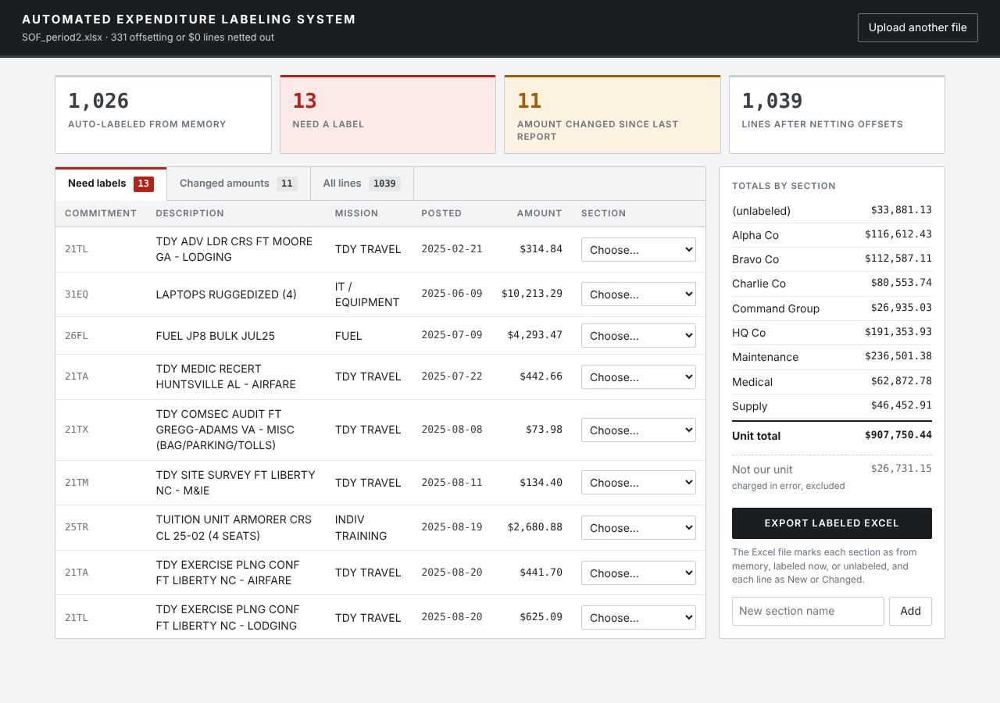

# Automated Expenditure Labeling System (AELS)

A locally run web application that automates the biweekly reconciliation of a unit's Status of Funds (SOF) report. The tool learns how each expenditure line is categorized, applies those categories automatically to future reports, and flags new lines, changed amounts and charges that do not belong to the unit.



---

## Background

Every two weeks a Status of Funds report is pulled from the financial system. It is an Excel export that lists every expenditure charged to the unit, line by line, and regularly exceeds 1,000 rows. Turning that export into a usable picture of spending required substantial manual work:

- **No spending category.** The report shows what was purchased but not which internal budget (section) the money came from. Every line had to be labeled by hand before spending could be totaled by section.
- **Misattributed charges.** Purchases made by other organizations were occasionally charged to the unit in error. Each one had to be identified manually so it could be corrected rather than counted as the unit's spending.
- **No memory between reports.** The financial system does not save labels and does not indicate which lines are new or which amounts have changed since the previous report. Each new export started from zero.
- **Hours of repeated effort.** Because the same lines had to be relabeled every cycle, reconciliation took several hours each time.

**Impact:** spending was not tracked consistently against the fiscal-year spend plan. It was difficult to confirm that funds were being used as intended, and deviations from the plan were not caught early enough to correct, which contributed to reductions in future budgets.

### Constraints

- **Must handle the raw export as-is.** The original Excel file is difficult to clean and automate: its layout varies between pulls (sometimes with a header row, sometimes without), descriptions and commitment items are terse system codes, charges and their reversals post as separate lines, and zero-dollar and blank rows are mixed in with real spending. The tool had to work through all of this without any manual reformatting before upload.
- **Must be usable by non-programmers.** It has a point-and-click browser interface, not a command line.

---

## Solution

The Automated Expenditure Labeling System (AELS) keeps a local database of every labeling decision and every amount it has seen, so each report only requires review of what is genuinely new.

| Problem | How the tool addresses it |
|---|---|
| Lines have no spending category | Each line is labeled with a section. Labels are stored permanently and applied automatically to the same item in every future report. |
| Misattributed charges | Lines can be labeled **Not our unit**. They are excluded from the unit's totals, reported separately for correction, and recognized automatically if they reappear. |
| No record of what is new or changed | Every line is compared with the previous report and marked **New** or **Changed (was $X)**, both on screen and in the exported workbook. |
| Offsetting entries inflate the report | Charge/reversal pairs on the same obligation are netted into a single line, and lines that net to $0 are removed. On a real report this cut the number of lines to review roughly in half. |
| Hours of manual totaling | The export includes a Summary sheet with totals by section, built from live Excel formulas. |

The first report requires a full labeling pass, or none at all if a previously hand-labeled report is uploaded. After that, only new items need attention: in the sample data, 12 of 1,039 lines. That reduces a multi-hour task to a few minutes.

---

## Features

- **Drag-and-drop upload** of the `.xlsx` report, with or without a header row
- **Import of existing labels:** if a report already has a Section column filled in by hand, those labels are loaded into the database, so years of manual work are not lost
- **Automatic labeling** from a SQLite database that grows with every report
- **Review queues** for:
  - lines that need a label (never seen before)
  - lines whose obligated amount changed since the previous report
- **Bulk labeling:** labeling one line applies the section to every matching line in the report
- **Misattributed-charge tracking** in a dedicated *Not our unit* category
- **Running totals by section** while you work
- **Labeled Excel export** with:
  - a color-coded section column (from memory / labeled this session / unlabeled)
  - a Status column (New / Changed with the prior amount)
  - a Summary sheet showing unit total, charges in error and report total
- **Custom sections** can be added from the interface

---

## How it works

```
Browser (index.html)          Flask (app.py)                Processing (processing.py)        SQLite (db.py)
────────────────────          ──────────────                ──────────────────────────        ──────────────
drop .xlsx  ───────────────▶  POST /api/upload  ──────────▶ read_sof()        Excel → rows
                                                            collapse_offsets() net +/- pairs
                                                            apply_labels()    ◀─────────────── labels
                                                            flag_changes()    ◀─────────────── sof_history
                                                                              ───────────────▶ save new amounts
choose a section ──────────▶  POST /api/label  ───────────────────────────────────────────────▶ save label
click Export     ──────────▶  POST /api/export ──────────▶ export_labeled()  → .xlsx download
```

### Data model

| Table         | Unique key                                     | Purpose                                         |
|---------------|------------------------------------------------|-------------------------------------------------|
| `labels`      | commitment item + description                  | Remembers which section each item belongs to    |
| `sof_history` | obligation doc + commitment item + description | Last known amount, used to detect changes       |
| `sections`    | name                                           | Section options shown in the interface          |

### Design decisions

- **Labels are keyed on commitment item + description, not on the obligation document.** The same recurring purchase appears under a new obligation number each cycle and should still be recognized.
- **Change detection is keyed on the obligation document.** The meaningful signal is that a specific obligation moved from one amount to another.
- **Header-aware parsing.** Columns are located by header name when a header row is present, so reordered or extra columns are handled. Headerless exports fall back to the standard column order.
- **Labels are saved immediately.** Each decision is written to the database the moment it is made, so no work is lost if the application is closed partway through a report.
- **Formulas in the export.** Section totals are `SUMIF` formulas rather than fixed values, so the workbook stays accurate if a label is edited in Excel afterward.

---

## Tech stack

| Layer      | Technology                         |
|------------|------------------------------------|
| Backend    | Python 3, Flask                    |
| Processing | pandas, openpyxl                   |
| Storage    | SQLite                             |
| Frontend   | HTML, CSS, JavaScript (no framework) |
| Testing    | pytest, GitHub Actions             |

---

## Getting started

### Prerequisites

- Python 3.10 or newer
- Git (optional; you can also download the repository as a ZIP)

### Installation

```bash
git clone https://github.com/<your-username>/automated-expenditure-labeling-system.git
cd automated-expenditure-labeling-system

python -m venv .venv
# macOS / Linux
source .venv/bin/activate
# Windows
.venv\Scripts\activate

pip install -r requirements.txt
```

### Running the application

```bash
python -m aels
```

Open <http://localhost:5050> in a browser. The application only listens on your own machine.

### Walkthrough with sample data

The `sample_data/` folder contains two consecutive biweekly reports from a fictional fiscal year. **All data in them is invented**, but it is built to resemble a real report:

| | `SOF_period1.xlsx` | `SOF_period2.xlsx` |
|---|---|---|
| As of | 15 Aug 2025 | 29 Aug 2025 |
| Raw rows | 1,324 | 1,370 |
| Lines after netting offsets | 1,007 | 1,039 |
| Total obligated | $886,228 | $934,481 |
| Section column | filled in by hand (previous cycle) | none (fresh export) |

The year totals about $1M across TDY travel (airfare, lodging, per diem, rental cars), individual training courses, purchase card buys, supply requisitions, repair parts, service contracts funded in monthly increments, bulk fuel, medical supplies and IT equipment. It also includes returns, cancelled requisitions, travel voucher settlements, and six charges that belong to other units.

1. Upload `SOF_period1.xlsx`. It represents the last report you labeled by hand in Excel. The tool imports 489 labels from its Section column and nets out 317 offsetting lines.
2. Click **Upload another file** and upload `SOF_period2.xlsx`, the next export, with no labels at all.
   - **1,026 of 1,039 lines are labeled automatically**, including the charges that belong to other units.
   - **12 lines need a label**: new trips, a new training class, new equipment, and a few lines left blank last cycle.
   - **11 lines are flagged under Changed amounts**: monthly contract funding increments and settled travel vouchers.
3. Label the remaining lines, then click **Export labeled Excel** to get the labeled workbook and Summary sheet.

To regenerate the sample files, run `python scripts/make_sample_data.py`. To reset the system's memory, delete `data/aels.db`.

### Configuration

| Environment variable | Default              | Description                                     |
|----------------------|----------------------|-------------------------------------------------|
| `PORT`               | `5050`               | Port the application listens on                 |
| `AELS_DATA_DIR`      | `data`               | Folder for uploads, exports and the database    |
| `AELS_DB_PATH`       | `data/aels.db`       | Overrides the database location                 |

---

## Testing

```bash
pip install pytest
pytest
```

The suite contains 22 tests covering:

- report parsing (with and without headers, reordered columns, invalid layouts)
- importing hand-entered labels from a Section column
- offset netting (full and partial reversals, zero-dollar lines, floating-point rounding)
- label memory and relabeling
- detection of new and changed lines
- exclusion of misattributed charges from unit totals
- the Excel export
- the complete upload → label → export workflow through the API

Tests run automatically on every push through GitHub Actions.

---

## Project structure

```
automated-expenditure-labeling-system/
├── aels/
│   ├── app.py              Flask routes and API
│   ├── processing.py       parse → net offsets → label → detect changes → export
│   ├── db.py               SQLite storage
│   └── templates/
│       └── index.html      user interface
├── tests/                  pytest suite
├── scripts/                sample data generator
├── sample_data/            two fictional reports for demonstration
└── docs/                   screenshot
```

---

## Data privacy

- The application runs entirely on the local machine and makes no external network requests.
- Uploaded reports, exports and the label database are stored in the local `data/` folder, which is excluded from version control by `.gitignore`.
- This repository contains only fictional sample data, generated by `scripts/make_sample_data.py`.

---

## Future improvements

- Suggest a section for new items based on similar descriptions or the same commitment item
- Track section totals across reports and compare them with the fiscal-year spend plan
- Package as a standalone Windows executable so it can be used without installing Python

---

## License

Released under the [MIT License](LICENSE).
